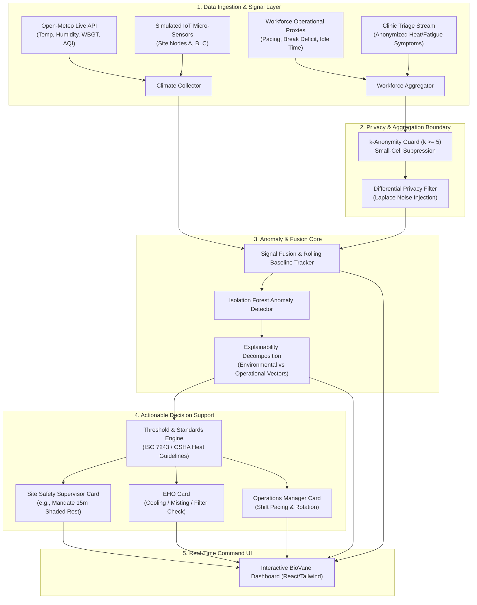

# Implementation Plan: BioVane - Micro-Climate & Shift Fatigue Anomaly Grid

## Goal Description
BioVane is an early warning system designed to protect outdoor, industrial, and logistics workforces (specifically in extreme heat regions like the GCC) from heat stress, environmental hazards, and acute fatigue before injury or downtime occurs. 

The system continuously fuses:
1. **Hyper-Local Micro-Climate Telemetry:** Live meteorological & IoT sensor data (ambient temperature, wet-bulb globe temperature [WBGT], relative humidity, particulate matter PM2.5/PM10, and AQI) via free meteorological APIs (Open-Meteo) and synthetic IoT sensors.
2. **Passive Workforce Operational Proxies:** Anonymous operational metrics (shift task-completion pacing, equipment idle times, break compliance rates, and anonymized clinic triage counts).

It applies **$k$-anonymity** and **differential privacy** to safeguard worker privacy, feeds joint vectors into an **explainable anomaly detection engine (Isolation Forest + Feature Contribution Decomposition)**, and outputs **role-specific actionable decision support** (for Site Safety Supervisors, Environmental Health Officers, and Operations Managers) in a real-time command dashboard.

---

## User Review Required

> [!IMPORTANT]
> **Proposed Project Location & Architecture:**
> We propose creating a dedicated project directory at `C:\Users\3C Tech\biovane` structured as a full-stack system:
> - **Backend:** Python (FastAPI + scikit-learn + NumPy/Pandas) for the anomaly engine, Open-Meteo micro-climate connector, differential privacy filter, and decision rules.
> - **Frontend:** React + Vite + Tailwind CSS + Lucide + Recharts for a real-time industrial command center dashboard.
> - **Live Simulation Mode:** Built-in scenario runner to simulate heat spikes, high dust/AQI surges, and shift pacing fatigue in GCC industrial zones.

> [!TIP]
> **No API Keys Required:** Micro-climate telemetry will use the free **Open-Meteo Weather & Air Quality APIs** (with GCC coordinates like Dubai/Riyadh/Doha default presets, plus simulated micro-climate sensor nodes) with zero external API key requirements.

---

## Open Questions

> [!NOTE]
> Please review the following architectural options. We can adjust based on your preference:
> 1. **Deployment & Stack:** Is the FastAPI + React (Vite/Tailwind) stack ideal for your workflow, or do you prefer a lightweight single-process Python app (e.g., Streamlit / FastAPI with server-rendered UI)?
> 2. **Target Region Defaults:** We will default the geographic telemetry presets to GCC industrial zones (e.g., Jebel Ali Industrial Zone - UAE, King Salman Energy Park - KSA, Mesaieed Industrial Area - Qatar). Would you like any other specific regions or custom coordinates included?
> 3. **Data Source Integration:** Should we include a CSV/JSON batch data replay feature in addition to the live API + real-time IoT simulator?

---

## Architecture Diagram

---

## Proposed Changes

We will create the project inside `C:\Users\3C Tech\biovane`.

### Backend: FastAPI & Anomaly Engine (`biovane/backend`)

#### [NEW] `requirements.txt`
Dependencies: `fastapi`, `uvicorn`, `pydantic`, `numpy`, `pandas`, `scikit-learn`, `httpx`, `requests`.

#### [NEW] `backend/app/main.py`
FastAPI application entry point setting up CORS, static file serving, and WebSocket/REST routes (`/api/telemetry`, `/api/anomalies`, `/api/decision-support`, `/api/privacy/audit`, `/api/simulate`).

#### [NEW] `backend/app/telemetry/climate.py`
Connects to Open-Meteo free API to fetch live hourly/current weather:
- Ambient temperature, relative humidity, wind speed, solar radiation.
- Wet-Bulb Globe Temperature (WBGT) calculation using standard Liljegren / Stull formulas.
- Air Quality API: PM2.5, PM10, dust concentration, AQI.
- Multi-zone micro-climate interpolator (simulating 4 distinct site sectors).

#### [NEW] `backend/app/telemetry/workforce.py`
Generates anonymous, aggregated shift operational proxies:
- Task cycle delay (% variance from baseline).
- Break compliance rate (% workers who completed scheduled rest cycles).
- Equipment idle time index.
- Clinic triage visit rate (anonymized incidence per 100 workers).

#### [NEW] `backend/app/privacy/guard.py`
Enforces privacy preservation:
- **$k$-Anonymity Validator**: Checks cohort size $n \ge k$ (default $k=5$). Suppresses cells with $<k$ observations.
- **Differential Privacy Filter**: Injects calibrated Laplace noise ($Lap(0, \Delta f / \epsilon)$) onto count and rate aggregates to guarantee mathematical zero-leakage of individual workers.
- **Privacy Audit Endpoint**: Exposes side-by-side comparison of pre-privacy vs post-privacy metrics for transparency verification.

#### [NEW] `backend/app/engine/anomaly_detector.py`
- Pre-trained and online-updating **Isolation Forest** trained on safe, baseline climate-workforce operational states.
- Calculates anomaly score ($[-1, 1]$ where negative values denote anomalies).
- **Feature Contribution Vector**: Computes normalized contribution of each parameter (WBGT deviation, PM2.5 surge, task delay rate, break deficit) so every alert has an explainable reason string.

#### [NEW] `backend/app/decision/rules.py`
- Implements OSHA / ISO 7243 Wet-Bulb Heat Stress standards and ACGIH threshold limit values.
- Generates structured, role-specific action directives:
  - **Site Safety Supervisor**: Trigger mandatory work-rest cycles (e.g., 45m work / 15m rest, hydration checkpoints).
  - **Environmental Health Officer (EHO)**: Deploy misting fans, inspect chilled air shelters, check particulate filtration.
  - **Operations Manager**: Throttle logistics throughput expectations, stagger shift handovers.

---

### Frontend: React Command Center (`biovane/frontend`)

#### [NEW] `frontend/package.json` & Vite setup
React 19 / TypeScript / Vite / Tailwind CSS / Lucide React / Recharts.

#### [NEW] `frontend/src/components/MicroClimateGrid.tsx`
Zone-by-zone micro-climate cards displaying live temperature, WBGT (with colored heat-stress risk categories: Green, Yellow, Orange, Red, Black Flag), Humidity, and AQI.

#### [NEW] `frontend/src/components/WorkforceProxyMonitor.tsx`
Visualizes shift pacing variance, equipment idle metrics, and break compliance rate over the last 12 hours.

#### [NEW] `frontend/src/components/ExplainableAnomalyRadar.tsx`
Interactive visualizer showing:
- Real-time Anomaly Threat Level (Normal, Elevated, Critical).
- Feature contribution bar/radar chart explaining *why* an alert fired (e.g., 58% WBGT spike + 31% pacing delay + 11% break deficit).

#### [NEW] `frontend/src/components/DecisionSupportHub.tsx`
Role-filtered action cards (Supervisor / EHO / Operations) with direct 1-click acknowledgement and protocol execution status.

#### [NEW] `frontend/src/components/PrivacyPreservingAudit.tsx`
Live privacy inspector demonstrating $k$-anonymity enforcement, small-cell suppression indicators, and differential privacy noise bounds.

#### [NEW] `frontend/src/components/SimulationController.tsx`
Interactive stress-testing slider/controls allowing the operator or demonstrator to simulate:
- Extreme mid-day heatwave (WBGT > 32°C).
- GCC shamal dust storm (PM10 > 350 µg/m³).
- Severe workforce fatigue wave.

---

## Verification Plan

### Automated Tests
1. **Telemetry & Climate Calculations:**
   - Verify WBGT calculation against standard test vectors (Liljegren equations).
   - Verify Open-Meteo client resilience with fallback synthetic generator if offline.
   - Command: `python -m pytest backend/tests/test_climate.py`
2. **Privacy Guarantees:**
   - Test $k$-anonymity suppression when cohort size $< 5$.
   - Test Laplace noise distribution under varying $\epsilon$ budgets.
   - Command: `python -m pytest backend/tests/test_privacy.py`
3. **Anomaly & Explainability Engine:**
   - Verify Isolation Forest flags anomalies on elevated stress conditions.
   - Verify feature explainability weights sum to 100%.
   - Command: `python -m pytest backend/tests/test_anomaly.py`

### Manual Verification
1. Launch backend (`python -m uvicorn app.main:app --port 8000`) and frontend (`npm run dev`).
2. Verify live micro-climate cards fetch and render coordinates (e.g., Dubai Industrial City).
3. Use the **Simulation Controller** to inject an acute heat spike and verify that:
   - Anomaly threat changes from "Normal" to "Critical".
   - Feature explainability updates dynamically.
   - Role-specific action cards are dispatched to the Safety Supervisor and EHO.
4. Verify privacy inspector shows raw vs anonymized aggregates without any worker-identifying information.
